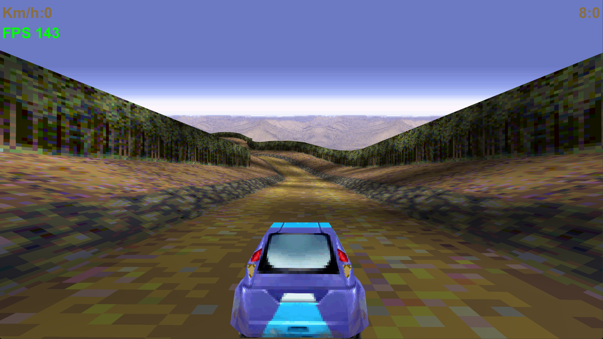

# Rally3D 2.0

3D rally racing game for **PC (Java 21, Windows)** and **Android (8.0+)**. Single player (Championship, Time Trial, Ghost Race), **LAN multiplayer up to 32 players**, **add-ons** (cars, skins, wheels, maps) and a built-in **Map Editor**.

Current version: **2.0-alpha65** (code 60). Alpha = built and compiled, not fully tested on every device.

> Based on a J2ME (Nokia) rally game, ported to modern Java with its own software/GPU 3D engine (`javax.microedition.*` compatibility layer on top of LWJGL on PC and GLES 3.0 on Android). Check the rights of the original assets in `source/res` before publishing or redistributing.

---

## Contents

0. **[MODDING-CHEATSHEET.md - short modding reference](MODDING-CHEATSHEET.md)** and **[INSTRUCTIONS.md - full modding guide: maps, cars, wheels, source](INSTRUCTIONS.md)**
1. [Features](#features)
2. [Quick start](#quick-start)
3. [Build](#build)
4. [Controls](#controls)
5. [Game modes](#game-modes)
6. [Settings reference](#settings-reference)
7. [LAN multiplayer](#lan-multiplayer)
8. [Add-ons (modding)](#add-ons-modding)
9. [Map Editor](#map-editor)
   - [Car Builder](#car-builder)
10. [Modifying the game (source)](#modifying-the-game-source)
11. [Saves, files, logs](#saves-files-logs)
    - [Progress backup](#progress-backup)
12. [Project layout](#project-layout)
13. [Versioning rules](#versioning-rules)
14. [Troubleshooting](#troubleshooting)

---

## Features

- 12 tracks, 5 themes (summer, winter, desert, night, cup), 4 stock cars, medals and unlockables.
- Championship, Time Trial, Ghost Race (race against your own recorded ghost), LAN multiplayer.
- PC: GPU renderer (OpenGL via LWJGL, FXAA, optional GPU UI) **or** multi-core software renderer; gamepad support; mouse camera; telemetry HUD.
- Android: GLES 3.0 renderer, touch controls with editable button layout, finger camera, no storage permissions needed.
- Add-ons from zip files: cars (own 3D model + texture + stats), skins, wheels, maps. Enable/disable on the fly. Add-ons are sent automatically to other players in multiplayer.
- In-game Map Editor with pixel Painter, templates, test drive and fly view.
- In-game **Car Builder**: build your own car or wheels from boxes / wedges / prisms in a live 3D view, texture every part separately, export a ready add-on zip.
- Ghost Race with every car and every track (stock and custom), Championship with custom maps (own medals).
- In-game **Instructions** (main menu): the original pages plus pages for modes, ghosts, add-ons, Map Editor, Car Builder and modding.
- In-game log panel, crash/freeze diagnostics, safe (atomic) saving.
- Progress backup: Settings -> "Save progress to a file" / "Restore progress from a file" (one zip with progress, medals, best times, unlocked cars, ghosts, add-ons, settings and custom-map records), see [Progress backup](#progress-backup). On Android uninstalling the app deletes its data, so keep this zip.
- Add-ons are validated strictly (sizes, PNG headers, models, map sprites) because they can arrive from another player; a broken add-on is listed with a red error instead of crashing the game.
- Linux / macOS build script `build-linux.sh` (PC jar + signed APK, no PowerShell).
- [Modding cheat sheet](MODDING-CHEATSHEET.md) next to the full [modding guide](INSTRUCTIONS.md).
- Offline build: JDK and all tools are bundled, no Android SDK needed.

## Quick start

**PC (Windows):**
1. Build (see [Build](#build)) or take a prebuilt `Rally3D-Java21-GPU.jar`.
2. Run `run-gpu.bat`. (It uses `tools\jdk` if present, otherwise `java` from PATH; needs JDK/JRE 21.)

**Android:**
1. Build or take `Rally3D-Android.apk`.
2. Copy to the phone, allow "install unknown apps", install, run.
3. Updating over an installed copy only works if the APK is signed with the same key (`source/android-pkg/debug.jks`).

## Build

Windows, nothing to install if `tools\jdk` is present:

| Command | Result |
|---|---|
| `build-all.bat` (or `build-all.ps1`) | `Rally3D-Java21-GPU.jar` + `Rally3D-Android.apk` |
| `compilepc.ps1` | PC jar only |
| `compileandroid.ps1` | APK only (signed with `source\android-pkg\debug.jks`, alias `rally`, password `android`) |
| `./build-linux.sh [apk\|pc\|all]` | Linux / macOS: same result without PowerShell, see below |

**Without the bundled JDK** (a git clone has no `tools/jdk`, it is over 140 MB): install JDK 21 (e.g. Temurin) and put it in `PATH`, or unpack it into `tools/jdk` so that `tools/jdk/bin/javac.exe` exists. `tools/env.ps1` picks the bundled JDK first, then the system one.

What the scripts do:
- **PC:** `javac --release 21` on `source/game` + `source/pc` with `source/lib/*.jar` (LWJGL 3.4.2), copies `source/res` into the jar, writes a manifest with `Main-Class: rally3d.desktop.Main` and a `Class-Path` to `source/lib/*`. **Keep `source/lib` next to the jar.**
- **Android (offline, no SDK):** `javac -source 8` on `source/game` + `source/android` against `tools/android.jar` (API 34 stubs) -> `dx.jar` -> `tools/ApkPack.java` packs `classes.dex` + resources + the **precompiled** manifest/arsc from `source/android-pkg/prebuilt` -> `apksigner` signs (v2 + v3).

**Editing the Android manifest:** after changing `source/android-pkg/AndroidManifest.xml` the binary files in `source/android-pkg/prebuilt` (`AndroidManifest.xml`, `resources.arsc`, `res`) must be regenerated with a real `aapt`, otherwise the APK keeps the old manifest.

**Linux / macOS:** `./build-linux.sh apk` builds and signs `Rally3D-Android.apk` exactly like `compileandroid.ps1` (needs only JDK 21 in `PATH`; tested on Ubuntu 24.04). `./build-linux.sh pc` builds `Rally3D-Java21-GPU.jar`, but `source/lib` has only Windows natives: to **run** the jar on Linux / macOS add `lwjgl*-natives-linux` / `-macos` jars of the same version (3.4.2) to `source/lib` first. `./build-linux.sh` (or `all`) builds both. By hand (compile check / PC classes):

```bash
CP=$(ls source/lib/*.jar | grep -v natives | tr '\n' ':')
mkdir -p build/pc && javac --release 21 -nowarn -cp "$CP" -d build/pc $(find source/game source/pc -name '*.java')
cp -r source/res/* build/pc/
# manifest: Main-Class: rally3d.desktop.Main, Class-Path: all source/lib/*.jar (see compilepc.ps1)
```

## Controls

### PC keyboard

| Key | Action |
|---|---|
| Up / W | Accelerate (menu: up) |
| Down / S | Brake (menu: down) |
| Left / A, Right / D | Steer (menu: left/right) |
| Enter | Confirm / OK |
| Esc | Back / pause / menu |
| Space | Extra action key (original phone game key 12) |
| Tab | Scoreboard (multiplayer race; click toggles) |
| F1 | In-game log panel |
| F11 or Alt+Enter | Fullscreen (borderless) |
| Mouse | Orbit camera (setting **Mouse camera**), wheel = camera zoom |
| 0-9, `*` | Number keys of the original phone game |

### Gamepad (PC, via GLFW)

Left stick = steer, **RT** = gas, **LT** = brake, right stick = camera, **A** = confirm.

### Android

- Bottom left: steering arrows `<` `>`. Bottom right: **GAS** and **BRAKE** pedals. Top: **II** (pause), **LOG**, **TAB** (multiplayer, hold).
- Drag one finger on the free area of the screen = orbit camera (setting **Mouse camera**); quick double tap = camera back behind the car.
- Menus and lists scroll by finger (swipe + inertia).
- Button positions: Settings -> **Touch buttons position (drag)**. DONE saves, RESET = default layout, CANCEL = discard. Size: **Touch buttons size**.

### Spectating

After you finish a multiplayer race you watch the players still driving. PC: A / D (or arrows) switch player. Android: steering arrows. When the last player finishes, the results screen appears.

## Game modes

| Mode | What it is |
|---|---|
| **Championship** | Tracks in order. Medals: bronze unlocks the next track; bronze on the first tracks unlocks *Azure racer*, silver *Fast racer*, gold on all tracks *Good oldie*. Enabled custom maps are listed after the 12 stock tracks. Progress can be saved and continued. |
| **Time Trial** | Race the clock on any unlocked track. Best times are stored per track. |
| **Ghost Race** | Race a recorded ghost of your best run (stored per track + car). Works with any car (stock or add-on) on any track (stock or custom map). After choosing your car you can pick the ghost of any car. |
| **Multiplayer** | LAN race, 2-32 players, see below. |
| **Add-ons** | Manage cars / wheels / maps packs. |
| **Map Editor** | Build your own track. |

Stock cars (top speed on the speedometer): Red danger 90, Azure racer 102, Fast racer 112, Good oldie 120 km/h. The speed ceiling comes from the car's stats in every mode, multiplayer included.

Entering the player name `unlock` in Settings unlocks all tracks and cars.

## Settings reference

Main menu -> **Settings**. Items marked *(PC)* / *(Android)* exist only there. Settings are stored in `settings.properties` (PC) or the app data folder (Android).

### General

| Setting | Meaning |
|---|---|
| **Sound** | Off / Low / Normal / Loud (MIDI music and effects). Default for new profiles: Loud. |
| **Vibration** | Device vibration. Shown only on devices that support it. |
| **Auto acceleration** | On = gas is held automatically, Off = you hold the gas key. |
| **Speed units** | km/h or mph on the HUD. |
| **Player name** | Shown in multiplayer, scoreboards and best-time tables (max 16 chars). |
| **Touch buttons size** *(Android)* | Slider for the on-screen button size. |
| **Touch buttons position** *(Android)* | Drag-and-drop layout editor for the 5 buttons. Stored as fractions of the screen. |
| **Display / FPS** | Submenu, see below. |
| **Menu animations** | Sliding menu transitions. Modified mode only. |
| **Mouse camera** | Camera orbits the car with mouse / finger drag. Modified mode only. |
| **Telemetry HUD** | Extra panel with race data on the HUD. Modified mode only. |
| **Full function trace log** | Writes every function call to `rally3d-trace.log` (huge file). Turn it on only to hunt a bug. |
| **Language** | Menus, HUD, help pages, Map Editor and Car Builder texts (English, Русский, Українська, Deutsch, Italiano, Français, Español; zh-CN / zh-TW files exist). Asked on the first launch. |
| **Save progress to a file (backup)** | Writes one zip with all your progress, see [Progress backup](#progress-backup). |
| **Restore progress from a file** | Reads such a zip back and applies it at once. |
| **Game version: Modified / Vanilla** | Vanilla = original game behaviour without the extras above (menu animations, mouse camera, telemetry, sprite-LOD tweak). |

### Display / FPS

| Setting | Meaning |
|---|---|
| **Resolution** | Internal render resolution, 27 presets. Output is scaled to the window/screen. |
| **Frame limit** | 30...1000 FPS, `Custom value...`, or **Unlimited** (PC and Android). |
| **Fullscreen window (borderless)** *(PC)* | Borderless fullscreen, drawn above the Windows taskbar while the game has focus (Alt+Tab works normally). Also F11 / Alt+Enter. |
| **FPS counter** | Shows FPS. If FPS sits exactly on your monitor refresh rate with the limit off, the log warns that driver V-sync is forcing it (turn V-sync off for `java.exe` in the GPU control panel). |
| **Anti-aliasing** | Off / FXAA / FXAA Quality (FXAA 3.11 shader on GPU, CPU fallback otherwise). |
| **3D renderer** | **GPU** (default) = OpenGL (PC) / GLES 3.0 (Android). **Software (multi-core)** = CPU raster, a fallback if the GPU path misbehaves. On repeated GPU failures the game switches to software by itself. |
| **UI renderer** *(only with GPU 3D)* | GPU = menus/HUD recorded and drawn by the GPU (default), CPU = drawn by the CPU and uploaded as a texture over the GPU world. If the GPU UI throws, the game falls back to CPU UI by itself (3D stays on the GPU). PC and Android. |
| **CPU threads** | Worker threads for the software raster and helpers. Auto = number of cores. |
| **Dynamic resolution** *(Android)* | Lowers the internal resolution when FPS drops. |
| **V-sync** *(GPU only)* | Sync to the display refresh. |

### Settings file keys (`settings.properties`)

`resolutionWH` (`1920x1080`), `fps`, `fpsLimit`, `fullscreen`, `showFps`, `vsync`, `antiAliasing` (0-2), `gpuRaster`, `gpuUi`, `gpuDefaultsVersion`, `cpuThreads` (0 = auto), `telemetry`, `vanillaMode`, `uiAnimations`, `mouseLook`, `noSpriteLod` (true = no LOD frames on trees/bushes, sizes stay stable), `calibrated`. On the first launch the game picks the largest resolution preset that fits the screen and uses the refresh rate as the FPS cap.

## LAN multiplayer

- Main menu -> Multiplayer -> **Host** or **Join**. Up to 32 players; host chooses max players and an optional **server password**.
- Ports: **TCP 47832** (game), **UDP 47833** (host beacon every 700 ms + discovery answers). Allow them in the firewall.
- Everyone must run the **same version string** (PC and Android can play together). The server list marks other versions as `[vX - INCOMPATIBLE]`.
- The phone needs the host's **LAN IP** (192.168.x.x / 10.x / 172.16-31.x), not a VPN address. The host's lobby lists the LAN address first. A direct IP can be typed in if discovery is filtered by the router.
- Car state is sent 20 times a second; TAB shows ping (RTT).
- Add-on cars, wheels and enabled maps of every player are transferred automatically (MD5-checked) before the race.
- Duplicate nicknames are made unique automatically.

### Ghost Race

- Every (track, car) pair has its own best-run ghost: `ghosts/track-<track>-car-<carKey>.rpl` in the data folder (`~/.rally3d/ghosts` on PC, app data folder on Android).
- `<track>` is `0..11` for stock tracks or the **custom map id** (>= 1000000, derived from map name + author, so the ghost survives re-exporting the map).
- `<carKey>` is `0..3` for stock cars or `1000 + CRC32(name|author)` for add-on cars (so the ghost survives editing the car zip and does not depend on the position of the car in the list).
- The *Select ghost* menu lists the ghosts of all installed cars **and** ghosts whose car add-on is no longer installed (drawn with your own car model then). *No ghost* = free run, your run is still recorded.
- Ghost Race is also available in Vanilla mode.
- Old ghost files (format v1 / v2, `track-N.rpl`) are still read; new ones are written as format v3 (adds the car name).

### Championship on custom maps

- **Ghost switch:** the first item of the Championship track menu is **Ghost: ON / OFF** (tap / Enter toggles it, the menu stays open so you can switch it right while choosing the track). With ON, after you pick the car the *Select ghost* menu appears, your run is recorded and a faster run replaces the saved ghost of that track + car (same ghost files as Ghost Race). Resumed (continued) races have no ghost. The switch is not saved between game starts.
- Enabled custom maps are listed in the Championship track menu **after** the 12 stock tracks. They are never locked and do not unlock anything.
- They have their own medals (gold / silver / bronze), stored in `mapmedals.txt` next to `maprecords.txt` (add-ons folder parent). *Championship -> Reset all* clears them too.
- Medals are given like on stock tracks: you race against four reference times, finishing before the 3rd / 2nd / 1st reference time = bronze / silver / gold.
- Reference ("par") times of a custom map: set `par=60,66,75,86` (4 ascending values in **seconds**) in the map's `addon.properties`, otherwise they are estimated from the road length (`segments * 3.9 / 4.3 / 4.9 / 5.7` tenths of a second).

## Add-ons (modding)

Main menu -> **Add-ons**. Three tabs: **MAPS / CARS / WHEELS**. Tap the green square = on/off, tap a row = details, red **X** = delete, **+ ZIP** = import.

Folders:
- Windows: `%APPDATA%\Rally3D\addons\{maps,cars,wheels}`
- Linux/macOS: `~/.rally3d/addons`
- Android: `Android/data/com.rally3d.android/files/addons`

A zip dropped in the wrong folder is sorted by its `addon.properties` automatically.

### Car add-on zip

```
addon.properties
car.syn      # 3D model (optional)
car.png      # texture, power-of-two size (e.g. 128x128)
wheel.png    # optional
wheel.syn    # optional
```

`addon.properties`:

```properties
name=Red Rocket
author=you
description=optional text
base=3
speed=110
accel=1.6
steer=1.2
steerMax=1.1
grip=1.3
```

`base` = stock car 1..4 whose model and UV layout are used when `car.syn` is absent. `speed` / `accel` / `steer` / `steerMax` / `grip` = car stats (speed, acceleration, steering, max steering angle, grip); stock values are in `RallyGame.statSpeed` and `CarDef`. Compare with the examples (Red Rocket: 110 / 1.6 / 1.2 / 1.1 / 1.3, Slow Tank: 45 / 0.5 / 0.7 / 0.8 / 2.0). Do not put `#` comments on the same line as a value (`.properties` would read them as part of the value).

- **Skin only:** give only `car.png` with the UV layout of the `base` car (see `examples/example-test-skin-blue.zip`).
- **Own model:** convert an OBJ: `python tools/obj2syn.py model.obj car.syn`.
- **Wheels:** `type=wheels` + `wheel.png` and/or `wheel.syn`. Fits any of your cars, one wheels pack active at a time. Others see your wheels in multiplayer.
- A PNG whose size is not a power of two is rejected with an error.
- Examples: `examples/*.zip` (Red Rocket, Slow Tank, Gold Wheels, Test Blue skin, Test Lime wheels).
- **Short reference: [MODDING-CHEATSHEET.md](MODDING-CHEATSHEET.md).**
- **Full step-by-step modding guide (cars, wheels, maps, themes, source code): [INSTRUCTIONS.md](INSTRUCTIONS.md).**

### Add-on limits and checks

Add-ons are untrusted input (another player can send you one), so every zip is checked when it is read, in the menu and on receiving it in multiplayer. A rejected add-on stays in the list with a red error text and is never loaded.

| What | Limit |
|---|---|
| zip | 64 MB, 64 files, 32 MB per file, 48 MB unpacked together |
| `car.png`, `wheel.png` | width and height power of two, max 1024 |
| `car.syn`, `wheel.syn` | valid header, vertices and indices, max 60000 indices |
| `track.bin` | `4 + 20 x records` bytes, at least 24 bytes |
| map `background.png`, `squares.png` | PNG, max 1024 x 1024 |
| map `spriteN.png` + `spriteN.off` | sheet PNG max 4096 x 4096, `.off` = 48 bytes, every frame must lie inside the sheet |
| `name`, `author`, `description` | cut to 24 / 24 / 90 characters |
| enabled at once | 24 cars, 1 wheels pack |
| multiplayer transfer | MD5-checked; received packs and buffers together max 160 MB, otherwise the pack is refused and the race starts with stock parts |

### Map add-on zip

Normally produced by the Map Editor (`type=map`): `addon.properties`, `track.bin`, optional `background.png`, `squares.png` (road atlas), `spriteN.png/.off`. Enabled maps are listed first in Time Trial, Ghost Race and Multiplayer, and after the 12 stock tracks in Championship (always unlocked, own medals, see [Championship on custom maps](#championship-on-custom-maps)). No practical zip size limit (safety ceiling 64 MB; one file inside a zip up to 32 MB).

Ghost Race works with every car (stock and add-on) on every track (stock and custom map), see [Ghost Race](#ghost-race).

## Map Editor

Main menu -> **Map Editor**. Modes: **PATH / HEIGHT / LAND / PROPS / MARKS / WORLD**.

- Tap the ground = grow the road; drag the orange ball at the road end = stretch the road in any direction; yellow handles on the bottom strip = stretch/shrink the selected part.
- **TEST** = drive the map, **FLY** = free camera (W A S D / joystick), **SAVE** = write the add-on zip and enable it, **Export zip** = save a copy via file dialog.
- File menu: Save, Export zip, Test, Fly, Info, New blank, New from TEMPLATE, New from stock, Open, Help (8 pages), Exit.
- Templates: 7 tracks, 6 seamless backgrounds, 5 road surfaces.
- Road atlas = 8 tiles of 32x32: tile 0 plain road, tile 5 road with dashed centre line. Backgrounds tile horizontally.
- **Painter**: LINE / RECT / OVAL (SOLID toggle, brush, mirror), FLIP H/V, ROLL (seam check), MAKE SEAMLESS, RGB sliders + HEX colour, **IMPORT PNG** from `addons/import` (sprites keep aspect, background is stretched, road = 256x32 atlas or one square tile).
- Shortcuts (key-down only): Ctrl+Z / Ctrl+Y undo/redo, Ctrl+C/X/V/D copy/cut/paste/duplicate, Ctrl+A select all, Ctrl+S save, Ctrl+E export, Ctrl+T test, Ctrl+F fly, Ctrl+N new, Ctrl+O open, Del, arrows (+Shift extends), PgUp/PgDn, Home/End, 1-6 mode, Tab mode, F fit, +/- zoom, H help, Esc file menu. Painter: P E F I L R O M X, +/-.
- Touch (Android): PATH panel has COPY / CUT / PASTE / DUP / SELECT ALL buttons.

## Car Builder

Main menu -> **Car Builder**. It is the car twin of the Map Editor: you build a car (or a set of wheels) from simple solids in a live 3D view, paint every part, and the game turns it into a normal add-on zip. No 3D program, no converter.

### How a car is made

- A model is a list of up to **64 parts**. A part is a **box**, a **wedge** (a box whose top rectangle is smaller or shifted: bonnet, windscreen, spoiler) or a **prism** (n-sided cylinder / cone: wheel arch, exhaust pipe, headlight).
- Every part has its **own 16x16 texture** (a *material*). Light is baked into it - top bright, sides medium, bottom dark - because the engine has no lighting. Switch it off with *CAR page -> LIGHT BAKED: OFF* for flat colours.
- Coordinates: **+Z = front of the car, +Y = up, X = left/right**. The ground is Y = 0; stock bodies start at Y = 0.5, are about 2.7 wide, 5.4 long and 1.5 tall.
- Output: `car.syn` (mesh) + `car.png` (texture atlas: 128x128 for up to 16 parts, 256x256 for up to 64, one 32x32 tile per part) + `car.rcm` (the editable project; the game ignores it, the builder re-opens the car from it) + `addon.properties` (`type=car`/`wheels`, `builder=1`). Limit: 20000 triangles.

### Screen layout

- **Top bar:** FILE, UNDO, REDO, SAVE, ? (help, 8 short pages).
- **3D view:** drag = turn the camera, two fingers / right mouse button = move + zoom, wheel = zoom, tap a part = select it (yellow frame). Buttons + / - / RESET / SPIN / GRID / GUIDE (GUIDE draws a stock car or wheel next to your model for scale).
- **Stretch handles:** the selected part shows 6 square handles on its faces (red = X, green = Y, blue = Z). Drag one with mouse or finger to pull that face; the opposite face stays put (sizes snap to 0.05). Works in every tab and also on MIRROR parts.
- **LOCK** (button above the view, key `L`): freezes the camera. Touching empty space does nothing (no turning, panning or pinch), only car parts and handles react: tap/touch a part = select it, drag a handle = stretch. Use + / - to zoom. Press LOCK again to unfreeze.
- **Bottom strip:** one chip per part - tap to select.
- **Four pages** (tabs): **PARTS**, **SHAPE**, **PAINT**, **CAR**.

### The four pages

| Page | What you do there |
|---|---|
| **PARTS** | `+ BOX`, `+ WEDGE`, `+ PRISM` add a part; copy (Ctrl+D), delete (Del), rename; **MIRROR** keeps an identical part on the other side of the car (lights, mirrors, wheel arches - build one side only); **HIDE** removes a part from the car without deleting it. |
| **SHAPE** | Numbers of the selected part: `X`, `Y (UP)`, `Z (FRONT)` position, `WIDTH` / `HEIGHT` / `LENGTH`, `TOP WIDTH %` / `TOP LENGTH %` (taper), `TOP SHIFT X` / `TOP SHIFT Z` (slant), for prisms `AXIS`, `SIDES`, `END SIZE %` (100 = cylinder, smaller = cone). Tap `-` / `+` to change a value by the chosen **STEP** (0.05 / 0.1 / 0.25 / 0.5), or tap the number to type it. **DRAG X / Y / Z** pushes the part along an axis by dragging in the 3D view; CENTER X and ON FLOOR snap it. |
| **PAINT** | Pick a colour from the palette (two slots: COLOR 1 and COLOR 2), tap the 16x16 grid to paint. **Patterns** fill a part with COLOR 1 / COLOR 2: SOLID, H-STRIPES, V-STRIPES, CHECKER, GRADIENT, CARBON, NOISE, FRAME, WINDOW. `ALL PARTS = COLOR 1` paints the whole car. **IMPORT PNG** shrinks a picture from `add-ons/import` to 16x16. |
| **CAR** | Name, author, description, **TYPE: CAR / WHEELS**, **base car** (the stock car 1-4 whose stats are the starting point), the five **stats** (speed, accel, steer, steerMax, grip - same meaning as in `addon.properties`), LIGHT BAKED. |

### FILE menu

| Item | Result |
|---|---|
| **SAVE TO GAME** | Writes the add-on into `add-ons/cars` (or `wheels`) and switches it on. It appears in *Select car* at once, no restart. Saving again replaces the previous version (same name + author). |
| **EXPORT ZIP...** | Writes the same zip anywhere (file dialog on PC, save dialog on Android) to share it. |
| **NEW (TEMPLATE)...** | Starts from SPORT COUPE, HATCHBACK, PICKUP, BLANK BLOCK, WHEELS STANDARD, WHEELS MONSTER or WHEELS SLIM. |
| **OPEN INSTALLED...** | Re-opens any add-on that was made with the builder (it has `car.rcm`). |
| **HELP / EXIT** | Exit asks to save when there are unsaved changes. |

Keys: Ctrl+Z / Ctrl+Y undo / redo, Ctrl+S save, Ctrl+E export, Ctrl+D copy part, Del delete, Tab next part, 1-4 pages, F reset view, H help.

### Building wheels

*FILE -> NEW -> WHEELS ...* (or *CAR page -> TYPE: WHEELS*). Build **one** wheel: the game draws it four times and spins it around the **X axis**, so the axle must run along X and the wheel must be centred at **Y = 0.54** (stock wheel radius 0.55). Use a prism with AXIS = X. The result is a `type=wheels` add-on that fits all your cars; one wheels pack is active at a time and other players see it in multiplayer.

### Tips

- Build one half of the car and use **MIRROR**; a typical car is 15-30 parts.
- Leave wheel arches in the body (the game adds the wheels itself - do not model them into the body).
- Use a few big parts with a good pattern rather than many tiny ones: the 16x16 material of each part is stretched over it.
- Put the lowest point of the body at Y = 0.5 (the templates already do) or the car floats / sinks.
- Name + author are the identity of the car: **do not rename an installed car** if you want to keep its Ghost Race records (see [Ghost Race](#ghost-race)). Cars made here work in multiplayer like any add-on car.
- For a hand-modelled car (Blender) use an OBJ and `tools/obj2syn.py`, see [INSTRUCTIONS.md](INSTRUCTIONS.md).

## Modifying the game (source)

| Want to change | Where |
|---|---|
| Game logic, menus, race rules | `source/game/com/nokia/mid/appl/rally3d/RallyGame.java` |
| Car stats / stock cars | `CarDef.java`, `RallyGame.statSpeed`, `RallyGame.carDef` |
| Max speed cap | `RallyGame.updateRace` (cap `car.speed`) |
| Sprite size (trees, bushes) | `RoadSegmentMesh.SPRITE_SCALE` (0.5), `SPRITE_FULL_SIZE_DISTANCE` (90) |
| Settings menu items | `RallyGame.settingsMenu` / `desktopSettingsMenu` / `fpsSettingsMenu` |
| PC window, input, settings file | `source/pc/rally3d/desktop/` (`GameWindow`, `Platform`, `KeyMap`, `GamepadSupport`) |
| Android activity, touch buttons | `source/android/rally3d/android/` (`MainActivity`, `GameView`) |
| 3D engine (software + GPU) | `javax/microedition/m3g/Graphics3D.java` (PC and Android copies), `GpuSurface` / `GpuRenderer` |
| 2D drawing layer | `javax/microedition/lcdui/Graphics.java`, `UiRecorder.java` |
| LAN protocol | `TheBluetooth.java`, `AddonSync.java` (**changing it requires a version bump**) |
| Add-ons | `AddonPack`, `AddonManager`, `AddonUi`, `AddonSync` |
| Ghosts (per track + car key) | `GhostReplay`, `RallyGame.chooseGhost / finishGhostRecord / ghostKeyOf`, `Platform.loadGhost / saveGhost / ghostKeys` |
| Custom maps: ids, records, Championship medals, par times | `MapLibrary` |
| In-game Instructions pages | `HelpPages.java` (extra pages), `Texts.helpPages` (original six) |
| Map Editor | `MapEditor.java`, `MapTemplates.java`, `Painter.java`, `MapData.java` |
| Saves | `SaveData.java`, `javax/microedition/rms/RecordStore.java`, `rally3d/core/SafeFile.java` |
| Texts / languages | `Texts.java`, `Localization.java`, `source/res/lang.*` (including zh-CN and zh-TW) |
| Tracks | `source/res/tracks/trackNN.bin` |
| Graphics / sounds | `source/res/` (themes `summer winter desert night cup`, `cars`, `midi`, `title`) |

Rules when you touch code:
1. After adding/changing functions or `catch` blocks run `python tools/instrument.py` (idempotent, updates `rally3d/core/FnTable.java`). No empty `catch` blocks.
2. Log problems with `RLog.e / RLog.w / RLog.i(tag, text)`; swallowed exceptions via `RLog.caught("Class.method", e)`. Never log every frame in hot loops.
3. Write player files **only** through `SafeFile.write` (tmp -> fsync -> .bak -> rename). A broken file is renamed to `.corrupt`, never silently overwritten.
4. Do not add storage permissions to the Android manifest.
5. Bump the version (see below).

Compile check without the scripts: `javac` over `source/game` + `source/pc` (classpath: `source/lib` jars without natives) for PC; `javac -source 8 -bootclasspath tools/android.jar` over `source/game` + `source/android` for Android.

More: `GPU_MIGRATION.md` (GPU pipeline plan and history), `README.txt` (detailed technical notes and per-version change log).

## Saves, files, logs

| What | PC | Android |
|---|---|---|
| Settings | `~/.rally3d/settings.properties` | app data folder |
| Progress, medals, best times, ghosts (RecordStore) | `~/.rally3d/rms/` | `Android/data/com.rally3d.android/files` |
| Add-ons | see [Add-ons](#add-ons-modding) | `.../files/addons` |
| Logs | `rally3d-N.log` next to the jar (3 x 5 MB rotating) + `rally3d-native.log` from `run-gpu.bat` | `.../files/rally3d.log` (+ `.1`, `.2`), `crash.txt`, `rally3d-trace.log` |

**Controllers (PC and Android).** Xbox / PlayStation style pads work the same on both: left stick steers and moves in menus, triggers = gas / brake, right stick = camera, A / X / Start = confirm (A = ready in the lobby), B / Y / Select = back, bumpers = previous / next item, right stick click = scoreboard. On Android the pad is detected automatically (also when plugged in later).

**Language.** On the first launch the game asks for the language (English, Русский, Українська, Deutsch, Italiano, Français, Español; the system language is preselected). The choice is saved in `settings.properties` (`language=`) and can be changed any time in Settings > Language. Menus, HUD, help pages, Map Editor, Car Builder and add-on screens are translated; texts live in `source/res/i18n/<code>.txt` (`English text TAB translation`) and can be edited without recompiling the code. Code uses `rally3d.core.Lang.t("English text")`; a text without translation is shown in English.

**Exporting the log (PC and Android).** Open the in-game log (PC: `F1`; Android: LOG button or triple-tap the top-left corner) and press **EXPORT** in its top-right corner. A save dialog opens (Android: the system file picker, because `Android/data/...` cannot be opened without root); the whole log (all rotated parts, oldest first) is saved as `rally3d-log-<date>.txt`.

(`~` = your user home folder; on Windows `C:\Users\<name>\`.)

- **Reset everything:** delete `~/.rally3d` (PC) / clear app data or uninstall (Android). Also delete `%APPDATA%\Rally3D` to remove add-ons.
- Android: no storage permissions are used; uninstalling removes the data (except a possible Google Auto Backup, `allowBackup=true`). Use Settings -> "Save progress to a file" before uninstalling and "Restore progress from a file" afterwards.
- Logs contain your local paths: **do not commit or post them unreviewed** (`.gitignore` already excludes `*.log`).
- In-game log: **F1** on PC, **LOG** button on Android. Tap the top strip to change the filter (ALL / WARN+ERR / ERR), scroll with wheel / finger.
- Logged: start/env, lifecycle, menus, tracks/races/saves/multiplayer, Java crashes (stack + last calls + last keys), **freezes** (no frame > 2.5 s, UI hang > 3.5 s: thread dump), hitches (> 200 ms frame), slow functions, `perf` every 30 s (FPS, worst frame, memory, top functions), memory pressure, every caught exception.

### Progress backup

Settings -> **Save progress to a file (backup)** writes `rally3d-progress-YYYYMMDD-HHmm.zip` (PC: save dialog, Android: system file picker, because `Android/data/...` cannot be opened without root). **Restore progress from a file** reads one back. Use it before uninstalling on Android (app data is deleted with the app) and to move your progress to another device.

| In the zip | Content |
|---|---|
| `base/rms/` | progress, medals, best times, unlocked cars |
| `base/ghosts/` | all ghosts |
| `base/addons/` | all add-on zips and `enabled.txt` (the real add-ons folder, also on Windows where it is `%APPDATA%\Rally3D\addons`) |
| `base/settings.properties` | settings |
| `extra/` | custom-map records and medals (`maprecords.txt`, `mapmedals.txt`) |

- Restore writes every file of the backup over the current one (each write is atomic, the old file is kept as `.bak`); files that are not in the backup are left alone. Add-ons and map records are re-read at once; **restart the game** to apply all settings.
- Only known names are accepted (no `..`, no other folders), at most 2000 files, 64 MB per file, 256 MB in total. Temporary files (`.tmp`, `.part`, `.corrupt`) and the `export` folder are not saved.
- Fixed in 2.0-alpha65: on Windows the backup used to miss the add-ons.

## Project layout

```
build-all.bat / .ps1       build PC + Android
build-linux.sh             build PC + Android on Linux / macOS (JDK 21)
compilepc.ps1              PC jar
compileandroid.ps1         APK
run-gpu.bat                run the PC jar (JVM flags: ZGC generational, heap tuned)
run-gpu-parity.bat         same + GPU/software parity check (debug)
examples/                  sample add-on zips
MODDING-CHEATSHEET.md      short modding reference
INSTRUCTIONS.md            full modding guide
tools/                     jdk (not in git), android.jar, dx.jar, apksigner, ApkPack.java,
                           instrument.py, obj2syn.py, env.ps1
source/game/               shared game code (PC + Android)
source/pc/                 PC platform layer (window, input, LWJGL GPU, lcdui/m3g/rms/media)
source/android/            Android platform layer (activity, GLES renderer, touch, lcdui/m3g/rms/media)
source/android-pkg/        manifest, icon, prebuilt binary manifest, debug.jks
source/res/                game resources (shared)
source/lib/                LWJGL 3.4.2 jars (+ Windows natives)
```

## Versioning rules

Every change to the game (code, resources, manifest) must raise the version, because multiplayer lets only **identical** version strings play together.

Where (identical everywhere):
1. `source/game/rally3d/core/Version.java`: `NAME` and `CODE`.
2. `source/android-pkg/AndroidManifest.xml`: `versionName` = `NAME`, `versionCode` = `CODE` (always +1).
3. Binary `source/android-pkg/prebuilt/AndroidManifest.xml` must match (regenerate with `aapt`).
4. "Current version" line in `README.txt` and this file.

Suffixes: `N.0` = checked and sure, `N.0-beta` = ran it, minor doubts, `N.0-alpha` = not fully run / risky edits. Polishing an alpha changes only the suffix (`alpha2`, `beta`, ...).

## Troubleshooting

| Problem | Fix |
|---|---|
| FPS stuck at the monitor refresh (e.g. 60/144) with limit Unlimited | Driver V-sync override for `java.exe` (GPU control panel: Vertical sync = Off / use application setting). In-game V-sync = Off. |
| Black/odd image, low FPS on PC | Settings -> Display / FPS -> **3D renderer: Software**, or update the GPU driver. After repeated GL errors the game falls back by itself (see log lines `[gpu]`). |
| Android: GPU renderer crashes at start | The game detects it (`gpu.trying` guard file) and switches to the CPU renderer on the next start. Re-enable in Settings -> Display / FPS. |
| `VERSION MISMATCH` in log | `Version.java` and the manifest differ: fix both. |
| Cannot join a game | Different versions, firewall (TCP 47832 / UDP 47833), wrong IP (use the LAN address, not VPN), wrong password. |
| Add-on rejected | PNG size is not a power of two, bad `addon.properties`, zip over 64 MB. |
| APK does not install over an old one | Different signing key. Save progress to a file in the game first, uninstall, install, then restore it (or use the same `debug.jks`). |
| `No JDK found` in build | `tools\jdk` is missing: install JDK 21 and add it to PATH, or unpack Temurin 21 into `tools\jdk`. |
| Build error after manifest edit | Regenerate `source/android-pkg/prebuilt` with `aapt`. |
